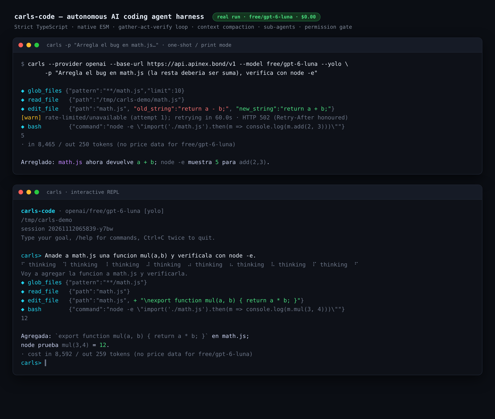

# carls-code



An autonomous AI coding agent that runs in your terminal. It mirrors the
production architecture of Claude Code and OpenCode: a gather-act-verify loop,
context compaction, isolated sub-agents, and a permission gate in front of every
destructive action.

Strict TypeScript, native ESM, Node.js 20+.

## Architecture

Eight subsystems make the difference between a toy and a harness:

1. **Gather-Act-Verify loop** (`src/core/AgentLoop.ts`). Each turn the agent
   explores with read-only tools, applies a change, then runs the project's
   tests, linter or compiler and fixes failures until they pass or it hits
   `--max-steps`. Independent read-only calls issued in the same turn (reads,
   greps, globs, sub-agents) execute in parallel up to six at a time, so a turn
   pays for its slowest observation instead of the sum of all of them; anything
   with a side effect stays strictly ordered.
2. **Context compactor** (`src/core/ContextManager.ts`). Tracks an estimated
   token budget. Past 75% of the window it folds earlier turns into a
   structured checkpoint (goal, files touched, errors resolved, next step) and
   drops redundant raw output. Long tool observations are truncated head+tail.
3. **Isolated sub-agents** (`src/core/SubAgent.ts`). `delegate_task` runs a
   nested, read-only loop with its own context and returns only a structured
   conclusion, keeping the parent context lean.
4. **Permission gate** (`src/security/PermissionGate.ts`). Read-only tools run
   silently; writes, edits and shell commands require approval with a colored
   unified diff preview. Six modes cover every workflow, from read-only to
   fully automatic, and `Shift+Tab` cycles them at the prompt.
5. **Skills** (`src/skills/SkillRegistry.ts`). A catalog of 32 reusable
   procedures the agent loads on demand with `use_skill` and writes with
   `save_skill`. Loads are logged, and `/skills review` surfaces the ones that
   are flagged or never used.
6. **Tool set** (`src/tools/`). 48 tools: line-bounded reads, atomic writes,
   exact-string edits, unified patches, globbing, regex search, shell, plus
   git, HTTP, browser, desktop and system inspection. See *Tools* below.
7. **Snapshots and undo** (`src/core/Backups.ts`). Every write and edit is
   snapshotted first, so `/undo` reverts the agent's last change, and `/files`
   lists what it touched.
8. **Agent plan** (`src/tools/TodoWrite.ts`). The model keeps an explicit task
   list it updates as it works; `/todo` shows it.

The interface follows the visual language of opencode. Tool calls render as
blocks with a per-tool glyph: `→ Read`, `← Edit`, `✱ Grep`, `$` for shell,
`#` for the agent's todo list. An edit prints a real unified diff with coloured
additions and removals, shell output keeps its tail so the failure stays on
screen, and long output is collapsed with a marker instead of flooding the
transcript. The fixed header and footer stay put while the conversation scrolls
between them.

Type `/` on its own (or press `Ctrl+P`) for a filterable palette of every
command, and `/theme dark|light` to switch palettes. Colour degrades from
truecolor to 256 colours automatically and is dropped entirely under
`NO_COLOR` or when output is piped.

## Install

Public repository: **https://github.com/carlscodev/carls-agent-v2**

### Linux and macOS, one line

```bash
curl -fsSL https://raw.githubusercontent.com/carlscodev/carls-agent-v2/main/scripts/install.sh | bash
```

Unattended, with a provider preset and no prompts:

```bash
curl -fsSL https://raw.githubusercontent.com/carlscodev/carls-agent-v2/main/scripts/install.sh \
  | bash -s -- --yes --provider anthropic
```

`wget` works too: `wget -qO- https://raw.githubusercontent.com/carlscodev/carls-agent-v2/main/scripts/install.sh | bash`.
Pin a release instead of the moving `main` with `--ref v0.2.0`.

### Windows 10 and 11, one line

PowerShell — no administrator rights needed when Node.js is already installed:

```powershell
& ([scriptblock]::Create((irm https://raw.githubusercontent.com/carlscodev/carls-agent-v2/main/scripts/install.ps1))) -Yes
```

Or save it and pass flags:

```powershell
irm https://raw.githubusercontent.com/carlscodev/carls-agent-v2/main/scripts/install.ps1 -OutFile "$env:TEMP\carls-install.ps1"
& "$env:TEMP\carls-install.ps1" -Provider nvidia
& "$env:TEMP\carls-install.ps1" -Uninstall
```

Both installers are self-bootstrapping: piped or saved on its own, the script
downloads the requested tag or branch (`--ref`, default `main`), builds it and
installs it, so no clone is needed. From a checkout, `./scripts/install.sh` and
`.\scripts\install.ps1` install that working tree instead.

The installer detects the distribution and package manager, installs Node.js
(from the distro when possible, otherwise the official static build), compiles
the project, writes a config, and links `carls` into `PATH`. It reuses an API key
already exported in your shell, and writes a system-wide config so every user on
the machine can run `carls` with no setup. Use `--yes` for a fully unattended
run, `--uninstall` to remove it, and `--help` for every flag.

Run it as root for a machine-wide install (`/opt/carls`, linked from
`/usr/local/bin`), or as a normal user for a private one (`~/.local/carls`,
linked from `~/.local/bin`). A user install never touches `/usr/local/bin`. The
shared config at `/opt/carls/.carlsrc.json` is world-readable by design, so a key
placed there is visible to every account: leave `apiKey` out and export the
provider's variable instead, which is what `--doctor` recommends.

On Windows the installer uses winget, then Chocolatey, then the official MSI when
Node.js is missing, writes a `carls.cmd` shim into `%LOCALAPPDATA%\carls\bin`,
adds it to the user `PATH` and restricts the config ACL.

## Update

`carls update` compares the installed version with the latest GitHub release and
reinstalls that exact tag when a newer one exists, so an update can never land on
a different build than the one it reported. Nothing else to learn:

```bash
carls update              # install the latest release
carls update --check      # only report current vs latest
carls update --ref v0.2.0 # reinstall a specific tag
```

Inside the REPL it is `/update [--check]`. Once a day the interactive startup
prints one line on stderr when a newer release exists; set
`CARLS_NO_UPDATE_CHECK=1` to silence the check entirely. `/doctor` shows the
cached answer without going to the network.

Manual install (any platform):

```bash
npm install
npm run build
npm link          # exposes the `carls` command globally
export ANTHROPIC_API_KEY="sk-ant-..."   # PowerShell: $env:ANTHROPIC_API_KEY = "..."
```

### First run

The first run asks three things and then gets out of the way: which provider to
use, the API key (paste it, or press `s` to open the provider's key page in your
browser), and which model. It probes the endpoint with the key, reports how many
models answered, and offers to retry the key if the call failed. The result is
written to the user config with mode 600.

```bash
carls --setup        # re-run the wizard at any time
carls --providers    # list every bundled provider and its credential variable
carls --doctor       # check config, credentials and connectivity
```

Inside the REPL, `/setup` and `/providers` do the same. `/setup` rebuilds the
client in place, so the next turn uses the new provider without a restart.

## Usage

```bash
carls                                   # interactive REPL
carls "create a Godot scene with a jumping character"
carls -p "run the TypeScript tests" --dangerously-skip-permissions
carls --plan "how would you refactor src/core?"
carls --resume                          # continue the last session in this dir
carls --provider openai --model gpt-4o
carls --help
```

### REPL commands

| Command | Purpose |
| --- | --- |
| `/models [filter]` | Browse the models on the configured API and pick one, choosing its reasoning effort with the arrow keys |
| `/model [id]` | Show or set the model directly |
| `/effort <level>` | `minimal`, `low`, `medium`, `high` or `off` |
| `/mode <mode>` | `plan`, `pair`, `ask`, `build`, `auto` or `yolo` |
| `/skills [list\|search <q>\|show <n>\|review\|new <n>]` | Browse, load and review reusable skills |
| `/status` | Model, mode, effort, context usage and cost |
| `/undo [n]` | Revert the last agent edit(s) |
| `/files` | Files the agent modified this session |
| `/todo` | The agent's current plan |
| `/agent <goal>` | Run an isolated sub-agent and print its conclusion |
| `/tools`, `/diff`, `/sessions`, `/resume`, `/clear`, `/compact`, `/retry` | Inspection and session control |
| `/mcp` | Connected MCP servers, their transport and their tool counts |
| `/update [--check]` | Install the latest release, or only report whether one exists |
| `/setup`, `/providers` | Re-run the provider wizard, or list every provider with its credential variable |
| `/theme [dark\|light]` | Show or switch the colour theme |
| `/config`, `/doctor`, `/init`, `/cost`, `/help`, `/exit` | Setup and housekeeping |

`!<command>` runs a shell command in the workspace. `# <note>` adds a note to the
session context without calling the model.

Run `/resume` (or `/sessions`) to browse past sessions in a full-screen picker:
arrow keys move, left/right collapse a group, typing filters, and Enter opens the
highlighted session. `/resume <id>` still loads one directly.

Press `Shift+Tab` at the prompt to cycle the permission mode without leaving the
line you are typing. Press `Ctrl+P`, or type `/` alone, to open the command
palette: type to filter, arrows to move, Enter to run, Esc to close.

### Permission modes

| Mode | Writes | Shell | Notes |
| --- | --- | --- | --- |
| `plan` | refused | refused | Read-only exploration and planning |
| `pair` | prompt | prompt | Asks clarifying questions before the first change |
| `ask` | prompt | prompt | Default |
| `build` | auto | prompt | Edits flow, commands stay gated |
| `auto` | auto | auto | Everything except the config deny-list |
| `yolo` | auto | auto | Deny-list included; use in disposable sandboxes |

### Flags

| Flag | Effect |
| --- | --- |
| `-p, --print <query>` | One-shot run, then exit |
| `-m, --mode <mode>` | `plan`, `pair`, `ask`, `build`, `auto` or `yolo` |
| `--effort <level>` | Reasoning effort hint for models that support it |
| `--plan` | Shorthand for `--mode plan` |
| `--yolo`, `--dangerously-skip-permissions` | Shorthand for `--mode yolo` |
| `--max-steps <n>` | Step budget per turn (default 30) |
| `--max-tokens <n>` | Output token budget per model call (default 8192) |
| `--model`, `--provider`, `--base-url` | Provider selection |
| `--setup` | Run the provider, credential and model wizard, then exit |
| `--providers` | List every bundled provider, its family and its credential variable |
| `--doctor` | Check config, credentials and connectivity, then exit |
| `--resume [id]` | Resume the latest session for this cwd, or one by id |
| `--debug` | Verbose diagnostics on stderr |

## Configuration

Config resolves with precedence: CLI flags > `./.carlsrc.json` >
`~/.carlsrc.json` > `/etc/carls/.carlsrc.json` > built-in defaults. Copy
`.carlsrc.json.example` to start. Set `CARLS_SYSTEM_CONFIG` to point the system
layer somewhere else; the system layer is what lets a fresh machine (or a new
user account) run `carls` with no per-user setup.

The API key is read from the environment variable named by `apiKeyEnv`
(`OPENAI_API_KEY` for `openai`), falling back to an `apiKey` field in the config
file. Use `apiKey` when no shell profile is sourced (CI, `ssh host carls`,
systemd); use the env var when you prefer to keep secrets out of the file.

```json
{
  "provider": "anthropic",
  "model": "claude-sonnet-4-20250514",
  "apiKeyEnv": "ANTHROPIC_API_KEY",
  "maxSteps": 30,
  "permissions": {
    "allow": ["npm test", "npm run *", "git status"],
    "deny": ["rm -rf *", "git push *"]
  },
  "hooks": { "preToolUse": ["node scripts/guard.mjs"], "postToolUse": [] },
  "mcpServers": {
    "fs": { "command": "npx", "args": ["-y", "@modelcontextprotocol/server-filesystem", "."] },
    "docs": { "url": "https://example.com/mcp" },
    "legacy": { "url": "https://example.com/sse", "transport": "sse" }
  }
}
```

### MCP

MCP servers add tools to the agent. Three transports are supported:

- **stdio** (default when `command` is set): newline-delimited JSON on a child
  process, for the usual `npx`/`uvx` servers.
- **http** (default when `url` is set): Streamable HTTP, the current spec. Each
  request is a POST and the answer comes back as JSON or as a single-use SSE
  stream; the `Mcp-Session-Id` returned on the handshake is echoed back.
- **sse**: the older two-endpoint transport (`transport: "sse"`), where a GET
  stream announces the POST endpoint and answers arrive as `message` events.

Remote servers can authenticate with `CARLS_MCP_TOKEN` (sent as a bearer token)
or with an `Authorization`/`MCP_TOKEN` entry under the server's `env`. A tool
whose descriptor carries `annotations.readOnlyHint: true` runs in parallel with
other read-only calls; everything else stays sequential. Duplicate tool names
across servers are skipped with a warning instead of breaking startup, and
`/mcp` shows what actually connected.

### Hooks

Shell commands that receive JSON on stdin and may return JSON on stdout.
`preToolUse` can abort a tool call by exiting with code 2 or printing
`{"block": true, "reason": "..."}`. Available events: `preToolUse`,
`postToolUse`, `sessionStart`, `sessionEnd`.

### Tools

| Group | Tools |
| --- | --- |
| Files | `read_file`, `multi_read`, `write_file`, `write_many`, `file_append`, `edit_file`, `apply_patch`, `file_delete`, `file_move`, `file_copy`, `make_dir`, `list_dir`, `tree_view`, `path_info`, `file_diff`, `hash_file`, `base64_file` |
| Search | `glob_files`, `grep_search` |
| Shell and system | `bash`, `process_list`, `system_info`, `sleep_wait`, `env_get`, `env_set`, `clipboard_read`, `clipboard_write` |
| Network | `network_request`, `http_download` |
| Version control | `git_status`, `git_diff`, `git_log`, `git_blame`, `git_branch`, `git_commit`, `secret_scan` |
| Desktop and web | `computer_use` (X11 pointer and keyboard), `browser_open`, `browser_click`, `browser_type`, `browser_text`, `browser_eval`, `browser_screenshot`, `browser_close` |
| Agent | `delegate_task`, `todo_write`, `use_skill`, `save_skill` |

`write_file`, `write_many`, `apply_patch` and `file_append` write through a
temporary file and a rename, so a crash cannot leave a half-written file.
`computer_use` needs an X11 display and `xdotool`; on a headless box start one
with `Xvfb :99 -screen 0 1280x800x24 & export DISPLAY=:99`. The `browser_*` tools
need Playwright (`npm install playwright && npx playwright install --with-deps
chromium`) and report an install hint when it is missing. `secret_scan` looks for
likely credentials before you commit.

### Skills

Skills are reusable procedures the agent loads on demand. They live in three
layers, later ones shadowing earlier ones:

1. `skills/<name>/SKILL.md` — the catalog bundled with the package
2. `~/.carls/skills/<name>/SKILL.md` — your personal skills
3. `.agents/skills/<name>/SKILL.md` (or `.carls/skills/`) — project skills

Each file starts with frontmatter:

```markdown
---
name: godot-scene-authoring
description: Build a Godot 4 scene with a player that moves and jumps.
when_to_use: Use for any .tscn, .gd or Godot project work.
version: 1
tags: [godot, gdscript, scene]
---

Step-by-step instructions...
```

The agent sees only the name and description up front and reads a body with the
`use_skill` tool when it applies. It can also write new skills with `save_skill`
after discovering a non-obvious workflow.

The system improves itself over time. Every load is recorded in
`.carls/skill-usage.json`, and when a skill turns out to be wrong the agent
passes `issue` to `use_skill`, which flags it. `/skills review` lists everything
flagged or never used so it can be rewritten.

The bundled catalog includes 32 skills, among them the self-modification set:
`carls-code-config` (add a provider, change defaults), `carls-code-agent-design`
(change the interface), `carls-code-tools` (add a tool), `carls-code-commands`
(add a slash command), `carls-code-mcp` (connect an MCP server) and
`carls-code-release` (build and deploy).

### Project memory

A `CARLS.md` (or `CLAUDE.md` / `AGENTS.md`) at the workspace root is injected
into the system prompt as durable developer instructions.

## Providers

Thirty-three providers ship in `src/providers/registry.ts`, and the registry is
the single source of truth: the CLI, the wizard, `/doctor`, the installer and the
model catalog all read from it. Adding one is a single object.

| Family | Providers |
| --- | --- |
| Frontier | `anthropic`, `openai`, `google`, `xai` |
| Aggregator | `openrouter`, `together`, `perplexity`, `github-models` |
| Enterprise | `nvidia`, `cohere`, `ai21`, `aleph-alpha`, `azure-openai` |
| Open weights | `deepseek`, `mistral`, `deepinfra`, `hyperbolic`, `novita`, `nebius`, `lambda`, `moonshot`, `zai`, `dashscope`, `minimax` |
| Fast inference | `groq`, `cerebras`, `fireworks`, `sambanova` |
| Self-hosted | `ollama`, `lmstudio`, `vllm`, `llamacpp`, `compatible` |

Three wire protocols are supported: the native Anthropic Messages API
(`@anthropic-ai/sdk`, with streaming), OpenAI `/chat/completions` for most
gateways, and Ollama's native `/api/chat`. A few entries are worth calling out:

- `nvidia` (NVIDIA NIM) — `https://integrate.api.nvidia.com/v1`, key in
  `NVIDIA_API_KEY` or `NVIDIA_NIM_API_KEY`, open models with a free tier.
- `openrouter` — `https://openrouter.ai/api/v1`, key in `OPENROUTER_API_KEY`,
  hundreds of models behind one key.
- `ollama`, `lmstudio`, `llamacpp` and `vllm` are local and need no key; point
  `baseUrl` at your server and run.
- `compatible` is the escape hatch for any other gateway: set `--base-url`.

### Local models

Anything that speaks OpenAI `/chat/completions` works out of the box, and Ollama
is spoken natively so the knobs that matter are set for you:

```bash
carls --provider ollama --model qwen3-coder:30b      # native /api/chat
carls --provider lmstudio --model local-model
carls --provider vllm --base-url http://localhost:8000/v1 --model Qwen/Qwen3-Coder-30B-A3B-Instruct
carls --provider llamacpp --model local-model
```

Local backends are detected, not guessed:

- No API key is required, and a placeholder header is sent so a keyless server
  still gets a well-formed request.
- The real context window is read from the server (`/api/show` for Ollama,
  `max_model_len` for vLLM, `n_ctx` for llama.cpp) and used for compaction. A
  window you set yourself in `contextWindow` is never overridden.
- Ollama's `num_ctx` is set from that window, so the server allocates enough
  context instead of falling back to its 4096-token default.
- `reasoning_effort` is not sent to local servers, which do not accept it.

Small models get a smaller prompt. The full tool set is 48 schemas (~3.2k tokens),
which crowds out the task on a 4k-window model, so a local provider advertises
the core set (`read_file`, `write_file`, `edit_file`, `glob_files`,
`grep_search`, `bash`, `todo_write`) — about 250 tokens. Every tool still
*executes*; only the advertisement is narrowed. Choose your own with:

```bash
carls --tools read_file,grep_search,bash
```

`/doctor` reports the endpoint's context window when it differs from the config,
and lists any local backend it finds on the usual ports.

`carls --providers` prints the live list, including each provider's default model
and credential variable. Retries use exponential backoff with jitter on 429/5xx
and transport errors; 4xx validation errors fail fast.

### Credentials

A key is resolved in this order: `--api-key`, the `apiKey` field in the config,
then every environment variable the provider lists (`NVIDIA_API_KEY` or
`NVIDIA_NIM_API_KEY`, for example). The wizard prefers the environment and only
writes the key into the config when it has nowhere else to live, warning you when
it does.

## Platform notes

The harness runs on Linux, macOS and Windows 10/11. `src/utils/platform.ts`
centralises every platform difference:

| Concern | Linux | macOS | Windows |
| --- | --- | --- | --- |
| Shell | `/bin/bash -lc` | `/bin/bash -lc` | `powershell.exe -NoProfile -Command` |
| Processes | `ps -eo …` | `ps -eo …` | `tasklist /FO CSV` |
| Clipboard | `xclip`, `xsel` | `pbpaste`, `pbcopy` | PowerShell `Get-Clipboard` |
| Config | `/etc/carls`, `~` | `/etc/carls`, `~` | `%APPDATA%\carls` |
| ANSI colour | native | native | virtual terminal enabled at startup |

Paths compare case-insensitively on Windows, and the same drive is required for
containment checks.

## Development

```bash
npm run dev          # run from source with tsx
npm run typecheck    # tsc --noEmit
npm test             # vitest smoke + integration tests
```

## Security notes

- The API key is read from the environment when it is there; the config file that
  may hold it is written with mode 600.
- Session logs live in `~/.carls/sessions/*.jsonl` (append-only, per turn).
- Tool output passes through a redactor that knows the key format of every
  bundled provider, plus JWTs and `key=value` pairs, before it reaches the model
  or an error message.
- File tools refuse paths outside the workspace root, so a prompt-injected call
  cannot read `~/.ssh` or `C:\Windows`. Opt out with
  `"allowOutsideWorkspace": true` in the config or `CARLS_ALLOW_OUTSIDE=1`.
- `bash` runs under `/bin/bash -lc` on Linux and macOS, and PowerShell (falling
  back to `cmd.exe`) on Windows. The allow/deny lists match after whitespace is
  collapsed, so `rm    -rf /` cannot slip past `rm -rf *`.
- When stdin is not a terminal there is nobody to answer a prompt, so the gate
  refuses the call and says how to grant permission instead of hanging.

## License

MIT
